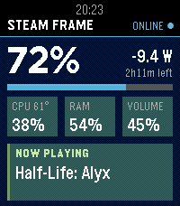
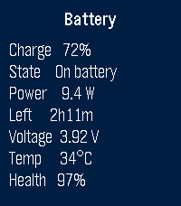
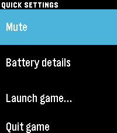
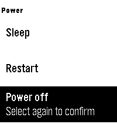
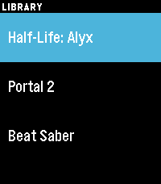

# Steam Frame for Pebble

Control and monitor your Valve Steam Frame from a Pebble Time 2.

<p>
    
</p>

- **Stats:** battery %, power draw, time left / time to full, CPU load and temperature, RAM, volume, what's playing
- **Battery details:** charge, state, watts, time left, voltage, temperature, health
- **Controls:** volume up/down, mute, launch an installed game, quit the running game
- **Power:** sleep, restart, power off (each needs a second press to confirm)

| Button | Main screen |
|---|---|
| Up / Down | Volume up / down (hold to repeat) |
| Select | Quick settings menu |
| Hold Select | Mute toggle |

## How it works

```
Pebble ⇄ Bluetooth ⇄ phone (PebbleKit JS) ⇄ Wi-Fi/HTTP ⇄ agent on the Frame
```

The agent ([agent/frame_agent.py](agent/frame_agent.py)) is one stdlib-only Python file running as a
systemd user service on the Frame. It reads `/sys` and `/proc`, controls volume with `wpctl`,
launches games through `steam steam://rungameid/<id>`, and asks Steam itself to sleep/restart/power
off (`SteamClient.System.*` over the Steam UI's local DevTools port, since `systemctl` from outside
the session needs a password). Everything except discovery and the one-time pairing needs the key.

## Setup

### 1. Agent on the Steam Frame

Open a terminal on the Frame (SSH, or Desktop Mode → Konsole) and run:

```sh
curl -LsSf https://raw.githubusercontent.com/OWNER/pebble-steamframe/main/agent/install.sh | sh
```

It installs to `~/.local/share/pebble-frame` (no sudo, survives SteamOS updates).

Uninstall: `systemctl --user disable --now pebble-frame && rm -rf ~/.local/share/pebble-frame ~/.config/systemd/user/pebble-frame.service`

### 2. App on the watch

Download `pebble-steamframe.pbw` from the [latest release](../../releases/latest) and open it with the
Pebble app on your phone, or build it yourself:

```sh
uv tool install pebble-tool
pebble sdk install latest
pebble build
pebble install --phone <phone-ip>
```

Open the app on the watch. That's it: it looks for the Frame as `frame.local` (SteamOS's default
hostname, over mDNS) or `frame` (Tailscale MagicDNS), then pairs. The first phone to ask gets the
key; after that the agent refuses new pairings.

- **Renamed your Frame?** Put its address in the app's settings on the phone (optional field).
- **New phone / "Frame paired to another phone"?** On the Frame: `rm ~/.config/pebble-frame/token`,
  then open the app again.
- Away from home, put phone and Frame on Tailscale.

## Notes

- Unofficial. Built on what other Frame projects found ([frame-control](https://github.com/saphid/frame-control),
  [frame-perf-overlay](https://github.com/sasaken1102r/frame-perf-overlay)); a SteamOS update can move things.
- Once the Frame sleeps the agent can't wake it; the watch shows "Can't reach Frame".
- The game list only covers the internal Steam library.
- Run the agent's check with `cd agent && python3 test_agent.py`.
