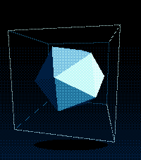
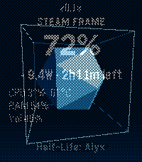

# Steam Frame for Pebble

Control and monitor your Valve Steam Frame from a Pebble Time 2.

<p>
     
</p>

- **Idle sculpture:** while you're not looking, a tumbling icosahedron in a wire cage, shaded only with
  ordered (Bayer) dithering. Tilt your wrist and the light moves; it turns green while charging, red
  when the battery's low, and spins faster when the Frame is busy. Flick your wrist (or press any
  button) and the stats dissolve in through the same dither pattern; after 10 s it fades back.
- **Steam look:** Steam's palette and layout (dark header with the blue underline, download-style
  battery bar, stat tiles, friends-list "NOW PLAYING" card, blue focus highlight). Steam's slate
  greys aren't among the Pebble's 64 colors, so they're dithered from the two nearest.
- **Stats:** battery %, power draw, time left / time to full, CPU load and temperature, RAM, volume, what's playing
- **Battery details:** charge, state, watts, time left, voltage, temperature, health
- **Controls:** volume up/down, mute, launch an installed game, quit the running game
- **Power:** sleep, restart, power off (each needs a second press to confirm)

| Button | Main screen |
|---|---|
| Flick wrist / any button | Show stats (from the idle sculpture) |
| Up / Down | Volume up / down (hold to repeat) |
| Select | Quick settings menu |
| Hold Select | Mute toggle |

## How it works

```
Pebble ⇄ Bluetooth ⇄ phone (PebbleKit JS) ⇄ Wi-Fi/HTTP ⇄ agent on the Frame
```

The agent ([agent/frame_agent.py](agent/frame_agent.py)) is one stdlib-only Python file running as a
systemd user service on the Frame. It reads `/sys` and `/proc`, controls volume with `wpctl`,
launches games through `steam steam://rungameid/<id>`, and asks Steam itself to sleep/restart/power
off (`SteamClient.System.*` over the Steam UI's local DevTools port, since `systemctl` from outside
the session needs a password). Everything except discovery and the one-time pairing needs the key.

## Setup

### 1. Agent on the Steam Frame

Open a terminal on the Frame (SSH, or Desktop Mode → Konsole) and run:

```sh
curl -LsSf https://raw.githubusercontent.com/fanden/pebble-steamframe/main/agent/install.sh | sh
```

It installs to `~/.local/share/pebble-frame` (no sudo, survives SteamOS updates) and starts on boot.
Prefer not to pipe into a shell? Copy the `agent/` folder to the Frame and run `sh install.sh` from it.

Uninstall: `systemctl --user disable --now pebble-frame && rm -rf ~/.local/share/pebble-frame ~/.config/systemd/user/pebble-frame.service`

### 2. App on the watch

Build it (needs the [Pebble SDK](https://developer.repebble.com/sdk/)):

```sh
uv tool install pebble-tool
pebble sdk install latest
pebble build
```

Then get `build/pebble-steamframe.pbw` onto the watch, either way works:

- **Same network:** turn on Developer Connection in the Pebble phone app, then
  `pebble install --phone <phone-ip>`.
- **From your phone, anywhere:** with the computer and phone on Tailscale, run
  `python3 tools/sideload.py` and open the address it prints on the phone. Tap **Download .pbw** and
  open the file with the Pebble app, or tap **Push** to install over Developer Connection.

Open the app on the watch. That's it: it looks for the Frame as `frame.local` (SteamOS's default
hostname, over mDNS) or `frame` (Tailscale MagicDNS), then pairs. The first phone to ask gets the
key; after that the agent refuses new pairings.

- **Renamed your Frame?** Put its address in the app's settings on the phone (optional field).
- **New phone / "Frame paired to another phone"?** On the Frame: `rm ~/.config/pebble-frame/token`,
  then open the app again.
- Away from home, put phone and Frame on Tailscale.

## Repo layout

| Path | What |
|---|---|
| `src/c/main.c` | Watch UI: stats, battery details, menus |
| `src/c/idle.c` | Idle sculpture and the dither dissolve |
| `src/pkjs/` | Phone side: finds the Frame, pairs, polls, relays actions |
| `agent/` | Agent for the Frame, its installer and a self-check |
| `tools/sideload.py` | Install page for your phone over Tailscale |

## Notes

- Unofficial. Built on what other Frame projects found ([frame-control](https://github.com/saphid/frame-control),
  [frame-perf-overlay](https://github.com/sasaken1102r/frame-perf-overlay)); a SteamOS update can move things.
- Once the Frame sleeps the agent can't wake it; the watch shows "Can't reach Frame".
- The game list only covers the internal Steam library.
- Run the agent's self-check with `cd agent && python3 test_agent.py`.
- Built for the Pebble Time 2 (`emery`). Other watches aren't targeted.
